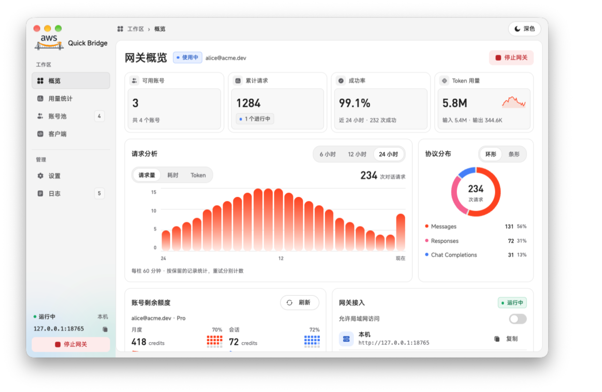
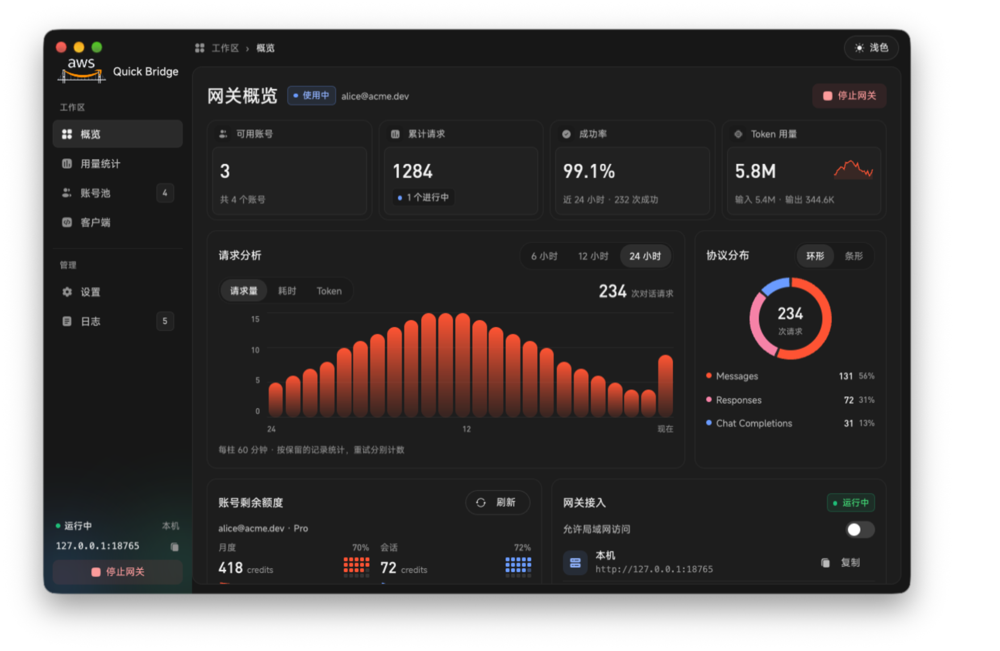
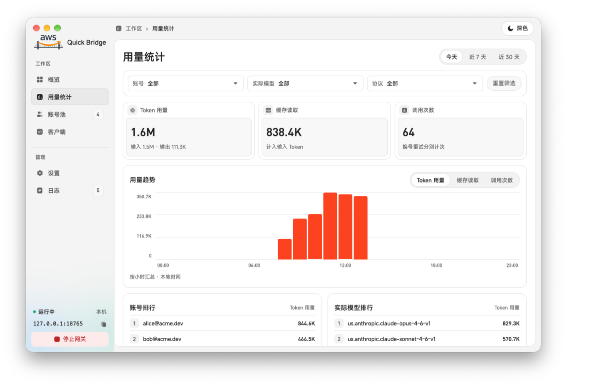
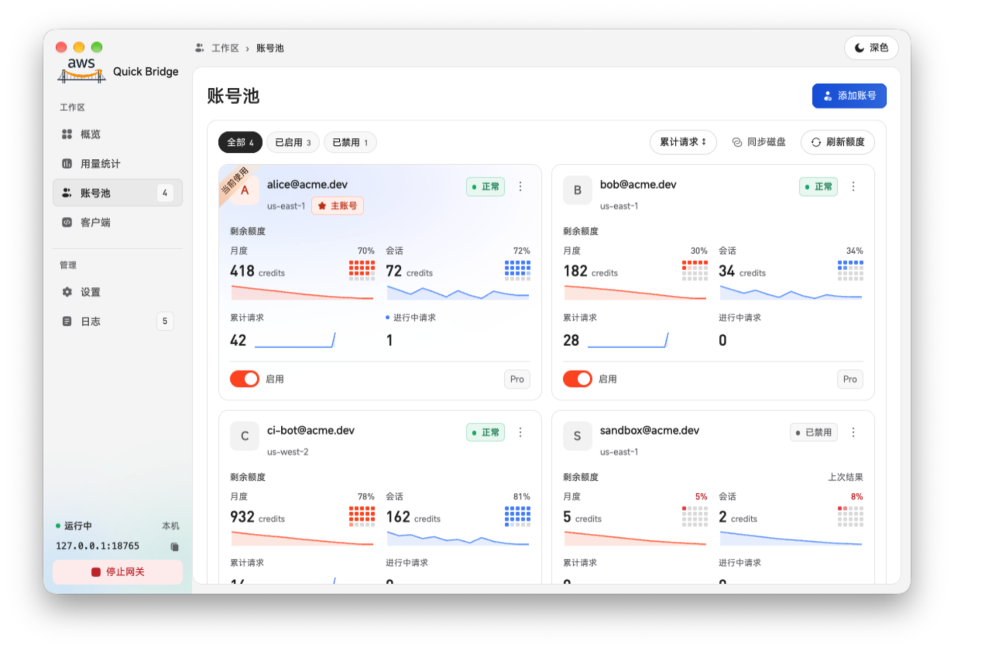
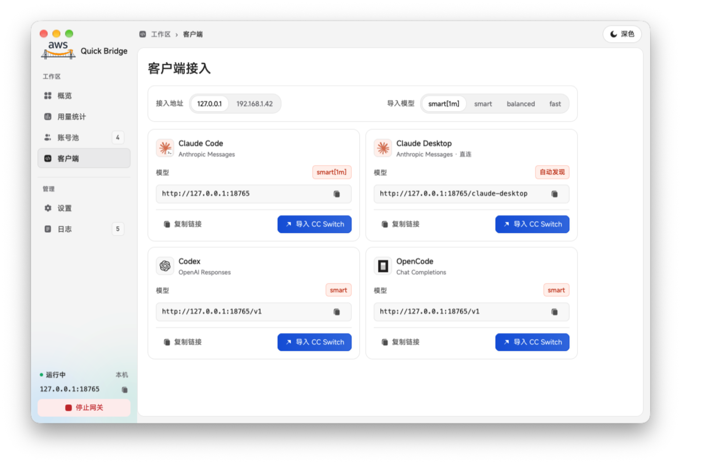

<p align="center">
  <picture>
    <source media="(prefers-color-scheme: dark)" srcset="assets/logo-dark.svg">
    
  </picture>
</p>

<h1 align="center">Quick Birdge</h1>

Rust 重写的 Amazon Quick（QuickWork）多协议桥接器，内置自主实现的类 Magpie 多账号池调度与跨平台 GPUI 原生桌面界面（支持 **macOS** 与 **Windows**，内置 **MiSans** 字体）。

## 界面预览



| 深色模式 | 用量统计 |
| --- | --- |
|  |  |

| 多账号池与额度曲线 | 客户端一键接入 |
| --- | --- |
|  |  |

## 核心能力

- **个人账号协议链路**：
  - Amazon Quick 个人账号原生桌面端 OAuth（PKCE S256、动态客户端注册、固定 `deviceId`、自动续期）。
  - AWS event-stream（CRC32）双向 WebSocket 帧编解码（AIDP）、HTTP `CONNECT` 代理隧道、25 秒应用层+WS 双心跳、`stop_generation`、`_chunked_frame` 重组、`resolved_model_id` 采集。
  - `<client_tool_call>` 客户端工具桥接流式解析（含未转义引号/控制符 JSON 容错修复）、64 KB 帧预算渐进压缩与附件转存（含 DLP 扫描）、多轮线程复用、CJK 语言保真提示。重启后可用本地摘要续接原 Quick 会话，摘要保留 24 小时。
- **自主实现原 Magpie 宿主能力**：
  - 多账号池（`~/.aws-quick-bridge/accounts.json` / `%USERPROFILE%\.aws-quick-bridge\accounts.json`，自动兼容同步 `account.json` 与 `config.json`）。
  - 会话粘性路由、并发上限控制、401 强制续期与过期故障切换。识别 Quick 作为普通回复返回的额度耗尽提示，自动冷却和切换账号。
- **三协议 HTTP 网关**：
  - `POST /v1/messages` & `/v1/messages/count_tokens`（Claude Code）
  - `/claude-desktop` 接入地址提供 Claude Desktop 专用的 Messages、Token 计数与模型发现接口。
  - `POST /v1/responses`（Codex）
  - `POST /v1/chat/completions`（OpenCode 等）
  - `GET /v1/models`、`GET /health`，支持本机 `127.0.0.1` 与局域网 `0.0.0.0` 一键切换。
  - 客户端取消或断开时自动停止上游生成，日志会标记取消的请求。
- **跨平台 GPUI 桌面端（Loopo 风格 + Solar Bold SVG + MiSans）**：
  - 随应用提供子集化 MiSans 2 个字重（Regular / Medium，含 4000+ 界面与常用汉字，生僻字自动回退系统字体）、矢量 SVG Logo（浅/深双色）与 27 枚 Solar Bold SVG 图标。macOS 通用包的两个架构共用一套无损压缩的字体文件，可使用 `sh scripts/subset-fonts.sh` 重新生成字集。
  - 支持事件驱动低延迟刷新、物理弹簧过渡动效、30 天本地聚合用量统计，以及额度查询、模型探测与 OAuth 登录等待全链路骨架屏。
  - macOS 使用透明标题栏 + 集成交通灯；Windows 使用原生标题栏、系统托盘驻留，并提供无黑框控制台专用入口 `aws-quick-bridge-gui.exe`。
  - 关闭窗口会收起界面，网关继续在后台运行。macOS 收起时隐藏 Dock 图标，可从顶部菜单栏打开面板或退出。Windows 通过系统托盘图标左键恢复或右键退出。设置中的「退出应用」会结束应用及其网关。

## Claude 直连接入

启动 Quick Bridge 网关后，可使用客户端的原生设置直连。

- **Claude Code** 在 `~/.claude/settings.json` 的 `env` 中设置 `ANTHROPIC_BASE_URL` 为 `http://127.0.0.1:18765`，`ANTHROPIC_AUTH_TOKEN` 为 Quick Bridge 的网关 API Key。[Claude Code 网关配置](https://code.claude.com/docs/en/llm-gateway-connect)
- **Claude Desktop** 在 macOS 或 Windows 的「客户端接入 → Claude Desktop」选择「一键接入」。Quick Bridge 会创建独立的直连配置并启动网关。Claude Desktop 正在运行时，配置会在它完全退出后写入，随后打开即可使用。可在原卡片选择「恢复原接入」。
- **通过配置文件接入 Claude Desktop**。在「客户端接入」选择「导出配置」，再从 Claude Desktop 的「Developer → Configure Third-Party Inference」右上角导入 JSON，应用更改并重启。导出文件包含网关密钥，请按密钥保管。[Claude Desktop 导入配置](https://claude.com/docs/third-party/claude-desktop/in-app-configuration#set-up-a-device-without-mdm)

模型选择器显示 Quick Smart、Quick Balanced 和 Quick Fast。默认挡位为 Auto 时，也会列出 Quick Auto。每次请求实际使用的模型以日志为准。

一键接入与导出配置使用 Desktop 模型发现接口提供的路由 ID。已有 Quick Bridge 配置可在客户端卡片上点「更新接入」。[模型列表设置](https://claude.com/docs/third-party/claude-desktop/models#model-list-and-default-model)

### 使用 CC Switch 导入 Claude Desktop

1. 在「客户端接入 → Claude Desktop」点击「导入 CC Switch」。CC Switch 4.0.39 支持此导入链接。
2. 在 CC Switch 确认导入并启用 Amazon Quick。如果 Claude Desktop 当前处于路由或聚合模式，切到「直连」后启用，再重新打开 Claude Desktop。
3. 导入生效后，Claude Desktop 从 Quick Bridge 获取模型列表。保持 Quick Bridge 网关运行即可。

也可通过 `cargo run --release -- ccswitch --app claude-desktop --open` 打开导入链接。

## 桌面自动更新

首个支持自动更新的正式版需要手动安装一次。此后应用在启动和后台运行时自动从 GitHub Releases 检查并下载适用的安装包。在「设置 → 应用 → 软件更新」可手动检查。下载完成后，可以选择「重启更新」，也可以在退出应用时安装。重启更新会等网关请求结束，更新后恢复更新前的网关运行状态。

发布时，GitHub Actions 用 Ed25519 给更新清单签名。初次启用时请在仓库外生成并备份签名密钥。将 PEM 私钥设为 Actions Secret `QUICK_BRIDGE_UPDATE_PRIVATE_KEY`，将最后一条命令输出的公钥设为 Actions Variable `QUICK_BRIDGE_UPDATE_PUBLIC_KEY`。后续版本沿用同一密钥签名，让已安装版本持续验证更新。

```sh
umask 077
openssl genpkey -algorithm Ed25519 -out quick-bridge-update.pem
openssl pkey -in quick-bridge-update.pem -pubout -outform DER | tail -c 32 | openssl base64 -A
```

## 构建与运行

### macOS

```sh
# 打包 Intel 和 Apple Silicon 通用应用（最低 macOS 13）
rustup target add aarch64-apple-darwin x86_64-apple-darwin
sh scripts/package-macos.sh
open 'target/release/Quick Bridge.app'

# 开发时直接启动桌面端
cargo run --release --bin aws-quick-bridge-gui

# 或命令行模式
cargo run --release -- serve --host 0.0.0.0
cargo run --release -- login
cargo run --release -- status
cargo run --release -- probe smart balanced fast
cargo run --release -- ccswitch --open
```

### Windows（MSVC 工具链）

需安装 Visual Studio Build Tools（含 C++ 桌面开发与 Windows 10/11 SDK，供 GPUI Direct3D 11 及 release 阶段 `fxc.exe` 着色器编译使用）：

```powershell
# 一键打包便携 ZIP（含 Quick Bridge.exe 与 aws-quick-bridge-rs.exe）
powershell -ExecutionPolicy Bypass -File scripts/package-windows.ps1

# 开发模式直接运行（运行时编译着色器）
cargo run --bin aws-quick-bridge-gui

# 发布构建（无黑框独立 GUI 可执行文件）
cargo build --release --bin aws-quick-bridge-gui
.\target\release\aws-quick-bridge-gui.exe

# 命令行模式
.\target\release\aws-quick-bridge-rs.exe status
.\target\release\aws-quick-bridge-rs.exe serve --host 0.0.0.0
```
